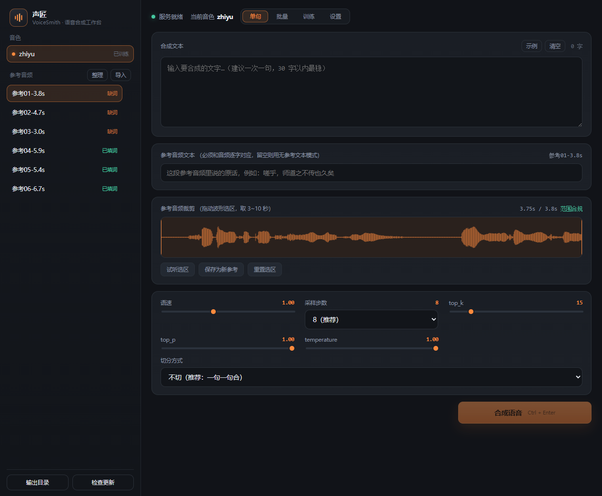
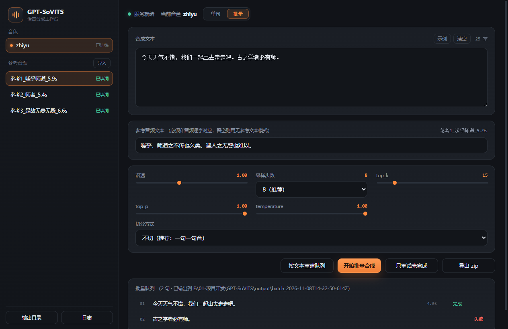
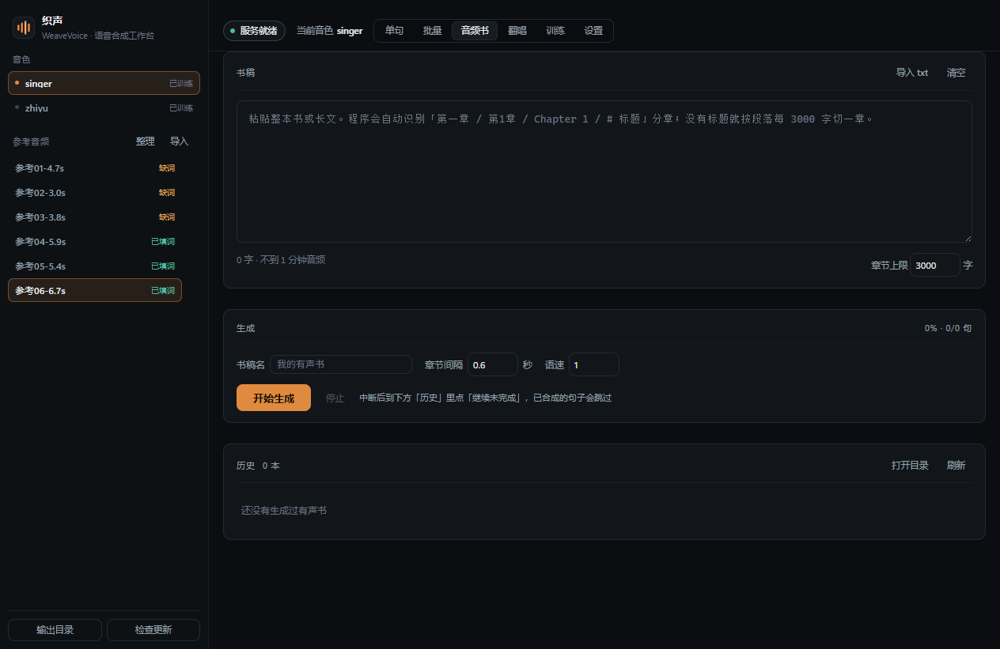
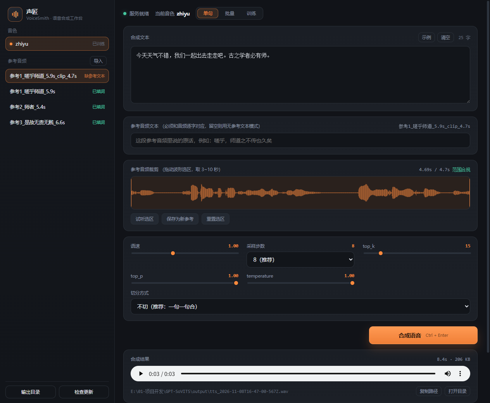
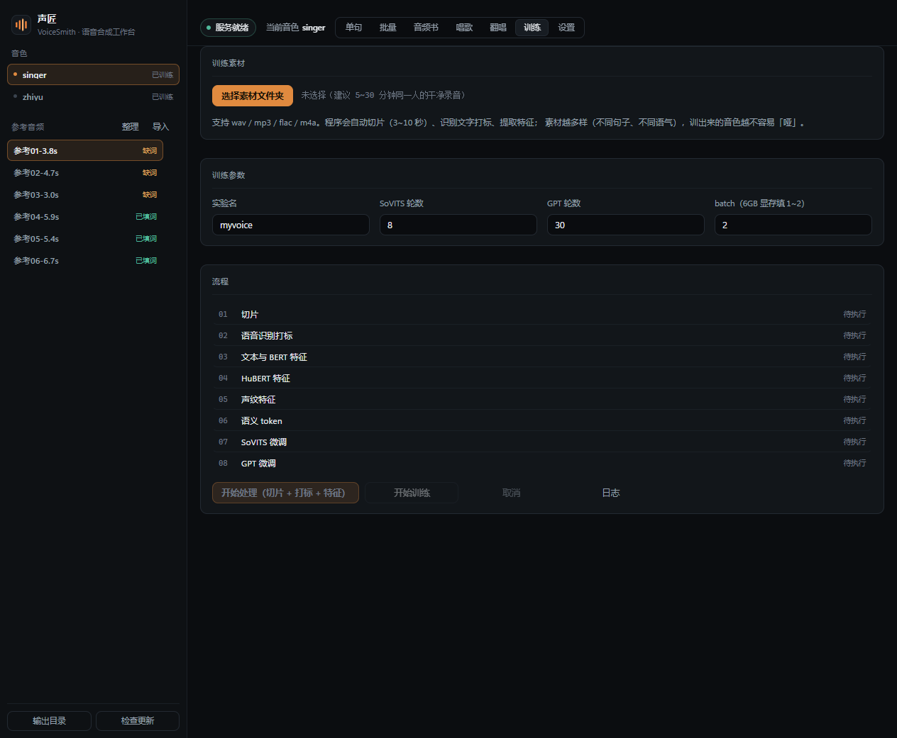
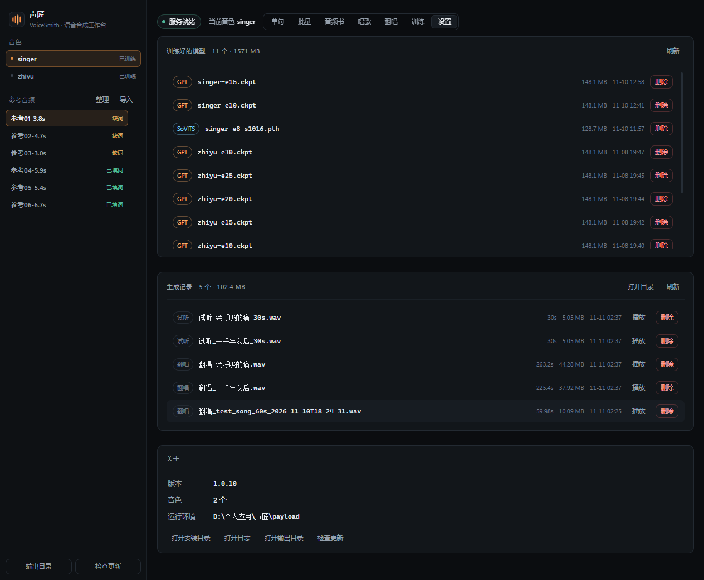

# 声匠 VoiceSmith

本地 AI 语音合成桌面端：**几十秒素材克隆音色，逐句/批量合成，全部跑在自己显卡上。**



## 它能做什么

- **原生桌面体验**：Electron + Vue 自绘界面，不是套浏览器壳的网页
- **音色克隆**：内置训练向导，选素材 → 自动切片打标 → 微调 → 直接试听
- **单句合成**：参考音频 + 参考文本 → 一句话出 WAV，带播放器和历史
- **音频书**：粘贴整本书自动分章，逐句合成，断点续跑，导出**带章节的 m4a**；可按章重做
- **参考音频管理**：波形上拖 3~10 秒选区裁新参考；一键去重整理成 `参考01-4.7s`；逐条删除
- **批量队列**：长文自动拆句、逐句合成、失败标红可重试、一键导出 zip
- **设置页**：查看训练好的模型、所有生成过的语音（播放 / 删除），版本与运行环境一目了然
- **自动更新**：GitHub Releases 推送，安装版启动自动检查（支持差分更新）







## 安装

1. 从 [Releases](https://github.com/DAKEZZ52/voicesmith/releases/latest) 下载安装包 `VoiceSmith-Setup-<版本>.exe`，以及运行环境分卷 `payload.7z.001` ~ `payload.7z.004`（共 5 个文件，放在同一目录）
2. 双击安装（装到用户目录，不需要管理员）
3. 首次启动会自动按序拼合 4 个分卷、解压运行环境（约 8.6 GB，1 分钟左右）
4. 首次启动会从 ModelScope 下载约 5.3 GB 预训练模型（只需一次）

> 运行要求：Windows 10/11 x64、NVIDIA 显卡（CUDA 12 驱动）、≥6 GB 显存、安装后约 15 GB 磁盘。

## 开发

```powershell
npm install
npm run dev                # 起 Vite
$env:VITE_DEV_SERVER_URL='http://localhost:5173'
$env:GPT_SOVITS_PAYLOAD='E:\path\to\GPT-SoVITS'
.\node_modules\electron\dist\electron.exe .
```

打包：

```powershell
npm run dist      # 只出本地安装包
npm run release   # 出包并发布到 GitHub Releases（需要 GH_TOKEN）
```

前端构建产物在 `dist/`，Electron 主进程在 `electron/`，训练与推理调用链都在主进程里。

## 架构

```
Vue 渲染进程
   │ IPC（contextBridge，无 nodeIntegration）
   ▼
Electron 主进程
   ├─ 拉起 runtime\Scripts\python.exe 跑 api_v2.py（FastAPI :9880）
   ├─ /tts 转发（绕开 file:// → http:// 的 CORS）
   ├─ 训练流水线：切片 → FunASR 打标 → 特征 → s2_train / s1_train
   └─ electron-updater：GitHub Releases 增量更新
```

## 数据放哪

| 内容 | 位置 |
| --- | --- |
| 参考音频与配置 | `%APPDATA%\voicesmith\` |
| 合成输出 | `<安装目录>\payload\output\` |
| 训练数据与权重 | `<安装目录>\payload\logs\`、`SoVITS_weights_v2Pro\`、`GPT_weights_v2Pro\` |

## 致谢与许可

- 语音引擎基于 [GPT-SoVITS](https://github.com/RVC-Boss/GPT-SoVITS)（MIT）
- 语音识别基于 [FunASR](https://github.com/modelscope/FunASR)（MIT）
- 界面与桌面壳：MIT，见 [LICENSE](LICENSE)

Powered by DAKEZZ52.
